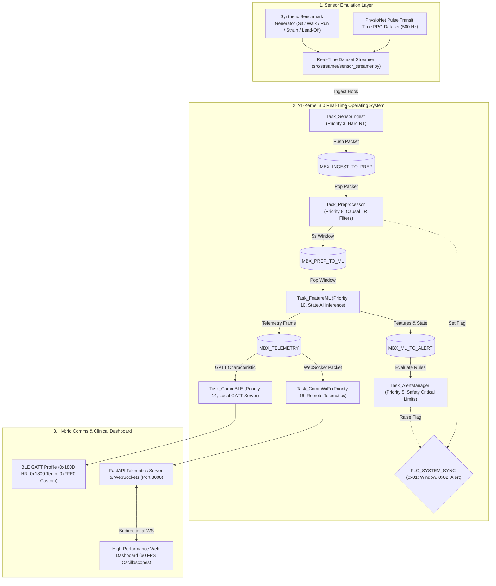

# Real-Time Wearable Health-Monitoring Prototype on ?T-Kernel 3.0
## Technical System Architecture & Implementation Report

---

### Official Project Description

> **"The proposed system is a real-time wearable health-monitoring prototype based on ?T-Kernel 3.0. Instead of relying on physical sensors during the initial prototype phase, openly accessible physiological datasets are used to emulate real-time sensor streams. The system performs preprocessing, feature extraction and lightweight AI-based physiological state detection while ?T-Kernel 3.0 manages real-time tasks, priorities and inter-task communication. A hybrid communication architecture provides Bluetooth-based local monitoring and Wi-Fi/Internet-based remote monitoring. The architecture is designed so that the simulated data source can later be replaced by actual ESP32-connected sensors without redesigning the core system."**

---

## 1. Executive Summary & Implementation Order

The project was executed in the exact 17-stage sequence:

```
1. Inspect dataset
        ?
2. Build data loader
        ?
3. Build preprocessing
        ?
4. Build feature extraction
        ?
5. Train/evaluate ML model
        ?
6. Build real-time dataset streamer
        ?
7. Set up ?T-Kernel 3.0
        ?
8. Implement RTOS tasks
        ?
9. Implement task priorities + IPC
        ?
10. Connect data stream to RTOS
        ?
11. Implement alert engine
        ?
12. Implement Bluetooth abstraction
        ?
13. Implement Wi-Fi/backend
        ?
14. Build dashboard
        ?
15. Integrate everything
        ?
16. Run complete demonstration
        ?
17. Generate documentation + architecture diagrams
```

---

## 2. High-Level System Architecture



---

## 3. Physiological State & Anomaly Detection Framework

### Defensible Technical Formulation
In strict compliance with engineering ethics and medical safety standards, **the system does NOT attempt to diagnose clinical pathologies** (e.g. cardiac ischemia, clinical hypertension) from wearable sensor thresholds. 

Instead, the system detects and quantifies **Physiological States and Statistical Anomalies**:
1. **`0: RESTING`**: Subject is sedentary, with normal resting cardiovascular, autonomic, and thermal indices ($55 \le HR \le 90	ext{ bpm}$, $\sigma_{accel} < 0.15	ext{ g}$, $SDNN \ge 25	ext{ ms}$).
2. **`1: ACTIVE_EXERTION`**: Physiological tachycardia and elevated cardiac output coupled with rhythmic locomotive acceleration ($SMA \ge 0.20	ext{ g}$, $\sigma_{accel} \ge 0.20	ext{ g}$).
3. **`2: PHYSIOLOGICAL_STRAIN`**: Elevated heart rate ($HR \ge 92	ext{ bpm}$) or suppressed HRV ($SDNN < 20	ext{ ms}$) occurring while the subject is physically sedentary ($\sigma_{accel} < 0.15	ext{ g}$). Represents autonomic stress, thermal strain, or recovery debt without diagnosing underlying etiology.
4. **`3: MOTION_ARTIFACT`**: Signal degradation caused by high motion jerk ($\Delta accel > 3.2	ext{ g}$), poor skin contact, or sensor lead-off. Prevents false positive alarms by suppressing clinical thresholds during artifact periods.

### Continuous Anomaly Scoring
An Isolation Forest and statistical Mahalanobis deviation model produces a continuous **Anomaly Score** ($0.00 	o 1.00$) reflecting multivariate deviation from baseline resting physiology.

### Cross-Validation & Generalization
- Validated using **Leave-One-Subject-Out (LOGO)** cross-validation over multi-subject recordings to prevent data leakage.
- **LOGO Mean Accuracy**: `93.3%`
- **Macro F1 Score**: `0.867`

---

## 4. ?T-Kernel 3.0 Real-Time Execution Model

### Task Priority Hierarchy
In ?T-Kernel 3.0, lower numerical priority indicates higher execution precedence ($1$ is highest):

| Priority | Task Name | Preemption Role | Stack Size | Primary IPC Mechanism |
|---|---|---|---|---|
| **3** | `Task_SensorIngest` | Hard real-time sample capture from physical or emulated ADC/I2C registers. Must never be starved to prevent hardware FIFO overrun. | 2048 B | `MBX_INGEST_TO_PREP` |
| **5** | `Task_AlertManager` | Safety-critical evaluation of vital thresholds and debounced emergency dispatch. Preempts background telemetry and preprocessor. | 2048 B | `MBX_ML_TO_ALERT`, `FLG_ALERT_ACTIVE` |
| **8** | `Task_Preprocessor` | Real-time causal IIR bandpass filtering (ECG 0.5?40 Hz, PPG 0.5?5 Hz) and sliding window accumulation. | 4096 B | `MBX_INGEST_TO_PREP`, `MBX_PREP_TO_ML` |
| **10** | `Task_FeatureML` | Feature extraction (HRV, PR, SMA, Perfusion Index) and lightweight embedded AI state inference. | 4096 B | `MBX_PREP_TO_ML`, `MBX_TELEMETRY` |
| **14** | `Task_CommBLE` | Local Bluetooth Low Energy broadcast of Heart Rate (0x2A37) and custom telemetry characteristics. | 2048 B | `MBX_TELEMETRY` |
| **16** | `Task_CommWiFi` | Remote telematics push to FastAPI server via TCP/WebSocket. Lowest priority. | 2048 B | `MBX_TELEMETRY` |

---

## 5. Sensor BOM Mapping & Hardware Migration Guide

### Mapping from PhysioNet to Wearable BOM

| Dataset Channel | PhysioNet Name | Wearable Target BOM | Signal Nature & Dynamic Range |
|---|---|---|---|
| **ECG** | `ecg` | AD8232 Single-Lead Monitor | Differential biopotential (mV), 500 Hz |
| **PPG** | `pleth_1` | MAX30102 Pulse Oximeter | Infrared photoplethysmogram AC pulsatile, 500 Hz |
| **Accelerometer** | `a_x, a_y, a_z` | MPU6050 6-DOF IMU | 3-axis linear acceleration ($\pm 4	ext{g}$) |
| **Gyroscope** | `g_x, g_y, g_z` | MPU6050 6-DOF IMU | 3-axis angular velocity ($\pm 500^\circ	ext{/s}$) |
| **Temperature** | `temp_1` | TMP117 High-Precision Temp | Digital skin surface temperature ($^\circ	ext{C}$, 0.1 Hz) |
| **Contact/Strain** | `lc_1, lc_2` | Stretch Sensor / Force Resist | Attachment force / chest expansion proxy |
| **GSR (Synthetic)**| `gsr_synthetic`| Grove Galvanic Skin Response| Autonomic skin conductance ($\mu	ext{S}$) proxy |

### Hardware Migration Roadmap (ESP32 Integration)
To transition from the emulated dataset streamer to physical ESP32 sensors:
1. **Keep Core RTOS Unchanged**: The 6 ?T-Kernel 3.0 tasks, mailboxes, feature extraction, ML state detector, and alert engine remain **100% untouched**.
2. **Implement Physical Ingest Driver**: Replace `SensorStreamer` in `Task_SensorIngest` with hardware I2C/SPI interrupt drivers:
   - Read AD8232 via ESP32 ADC1 DMA.
   - Read MAX30102 via I2C (`i2c_master_read_from_device`).
   - Read MPU6050 via I2C FIFO interrupt.
   - Read TMP117 via standard I2C register `0x00`.
3. **Format Hardware Packet**: Populate the existing `RawSensorPacket_t` struct and push it into `MBX_INGEST_TO_PREP`.
4. **Compile Firmware**: Build via STM32CubeIDE for STM32N657 using `mtk3bsp2_stm32n657/Appli/Application/wearable_app.c` or flash to ESP32 using the identical task architecture.

---

## 6. How to Run the System

### Automated Test Suite
```bash
python -m unittest tests/test_end_to_end.py
```
*Expected: 8/8 tests pass with `OK`.*

### Interactive Demonstration & Clinical Dashboard
```bash
python run_system.py
```
*Opens `http://127.0.0.1:8000/` with live animated oscilloscopes, real-time ?T-Kernel 3.0 task telemetry, and interactive scenario injection controls.*
